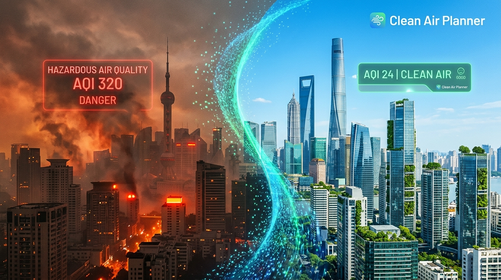

# Clean Air Planner – Urban Air Quality Assistant (Challenge 6)

> **Live Deployment:** [https://urban-air-assistant-one.vercel.app/](https://urban-air-assistant-one.vercel.app/)

**Vertical:** Families and communities coping with severe urban air pollution and winter smog.
Enter a city, specify who needs protection, how you travel, and indoor appliances. You get a prioritized, context-driven daily routine where each recommendation details its **quantified direct impact**.

---

## 🛠️ Tech Stack

| Layer | Technology | Details |
| :--- | :--- | :--- |
| **Frontend** | Vanilla HTML5 / CSS3 / Modern JS | Accessible semantic markup, auto dark-mode, reduced motion, 0 bundle dependencies |
| **Backend & Compute** | Vercel Serverless Functions | Node.js 20+ ES Modules (`api/advice.js`), in-memory grid caching, rate limiting |
| **GenAI Service** | Google Gemini API (`gemini-2.5-flash`) | Concise public health narrative synthesis, prompt-injection immune design |
| **Air Quality Telemetry** | Open-Meteo APIs (CAMS model) | Real-time global geocoding + US AQI & PM2.5 data (no user tracking) |
| **Test Runner** | Native Node Test Suite (`node:test`) | Unit tests for EPA band boundaries, decision logic, and security validation |
| **Deployment** | Vercel | Strict Content-Security-Policy (CSP), HSTS, nosniff headers |

---

## How it works
1. `POST /api/advice` validates input against strict allow-lists (`lib/validate.js`).
2. The city is geocoded and live **US AQI + PM2.5** are fetched from Open-Meteo (CAMS data, no API key), cached 10 min per ~1 km grid cell.
3. `lib/aqi.js` (pure functions) applies decision rules: AQI band × vulnerable members × commute × home sources → prioritised actions with an impact statement and a cigarette-equivalent exposure figure.
4. If `GEMINI_API_KEY` is set, **Gemini** writes a short plain-language summary. Its prompt holds only numbers, enums and the geocoded place name, never raw user text, which limits prompt injection. Without a key the rule-based plan still works.

## Design choices
- **Code quality:** zero runtime dependencies, pure logic separated from I/O, JSDoc types, small functions.
- **Security:** API key server-side only; allow-list validation; strict CSP (`script-src 'self'`), no `innerHTML`; HSTS, nosniff, no-referrer; per-IP rate limit; 6 s upstream timeouts; generic error messages.
- **Efficiency:** in-memory cache, `maxOutputTokens` cap, static frontend with no framework or bundle.
- **Testing:** `npm test` (Node built-in runner, no install) covers band boundaries, decision rules and validation/injection cases.
- **Accessibility:** semantic landmarks, labelled fieldsets, skip link, live status region, focus moved to results, AQI conveyed by text not colour alone, 44 px targets, dark mode, reduced motion.

## Deploy on Vercel
1. Push to a public repo (single branch), then **Import** it at vercel.com (no build settings needed).
2. Optional: add env vars `GEMINI_API_KEY` and `GEMINI_MODEL` (see `.env.example`).
3. Run locally with `npx vercel dev`; run tests with `npm test`.

## Assumptions
- Open-Meteo's modelled city-level AQI approximates local conditions. Impact figures (N95 ≈ 95% filtration, HEPA 50–70%, 22 µg/m³ ≈ 1 cigarette) are widely cited approximations, labelled as such.
- General guidance only, not medical advice.
